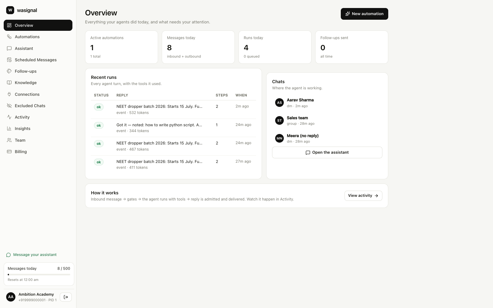
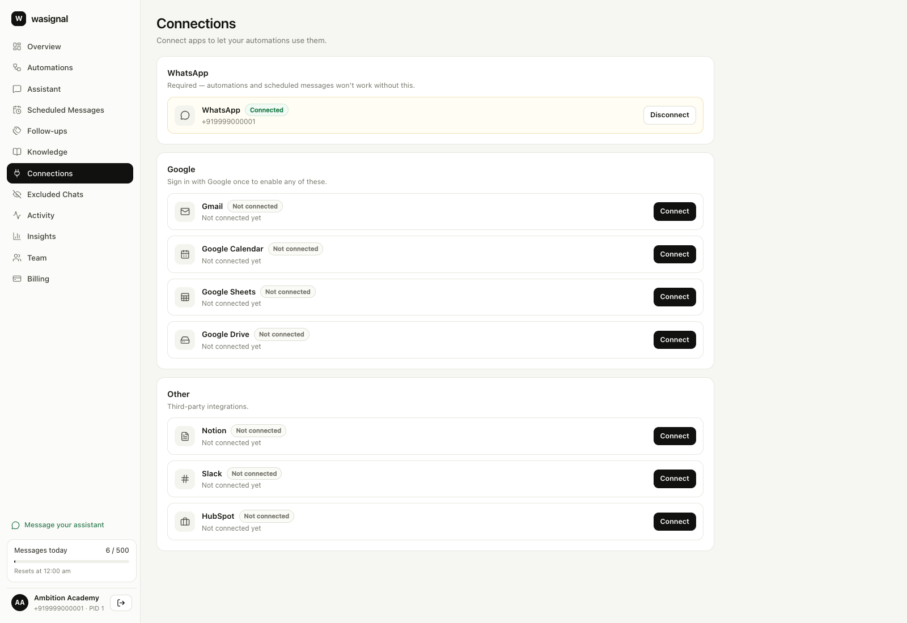
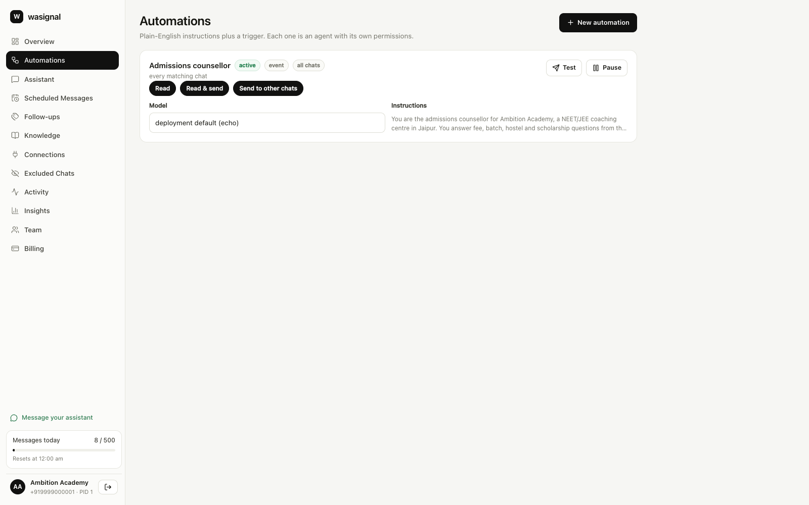
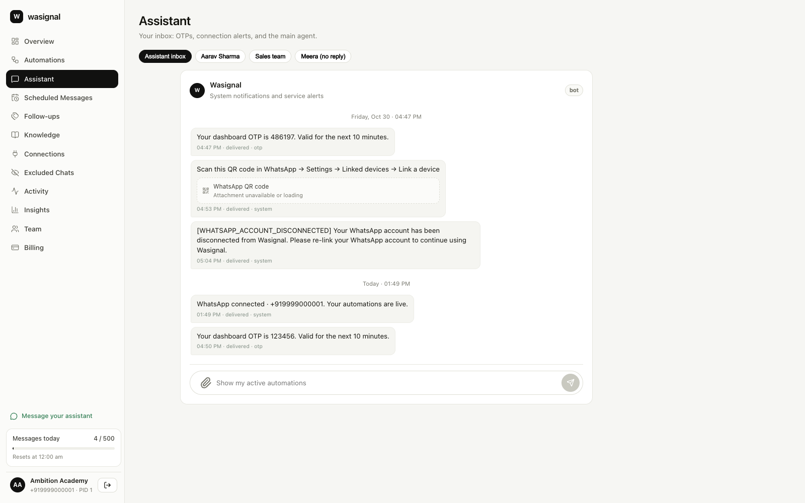

# Wasignal — WhatsApp-native AI agents

A working scaffold of the architecture we reverse-engineered from Loop2: the AI
agent lives **on the customer's existing WhatsApp number**, replies through a
linked-device bridge, and follows up on its own schedule.

This repo is a *buildable skeleton*, not a product: the pipeline, runtime, tools,
capabilities, scheduling, tenancy and UI are real and tested; the WhatsApp
transport and the LLM are swappable adapters.

```
apps/api   FastAPI + SQLite + agent runtime + scheduler   (runs offline)
apps/web   Next.js dashboard + same-origin API proxy
docs       architecture, bridge contract
```

> Full reverse-engineering notes and the build playbook:
> `../loop2-architecture-playbook.md`.

---

## Quickstart

### 1. API

```bash
cd apps/api
python3.12 -m venv .venv
.venv/bin/pip install -r requirements.txt
.venv/bin/uvicorn app.main:app --reload --port 8000
```

First boot seeds a demo tenant:

| | |
|---|---|
| phone | `9999000001` |
| OTP (dev) | `123456` |
| agent | "Admissions counsellor" (NEET/JEE coaching) |
| knowledge | fee list, hostel, scholarship |
| chats | Aarav (DM), Sales team (group), Meera (quiet lead) |

API docs: http://127.0.0.1:8000/docs

### 2. Web

```bash
cd apps/web
npm install
npm run dev
```

Open http://localhost:3000 → sign in with `9999000001` → the UI shows the code in
development (it would be a WhatsApp message in production).

### 3. Try the loop

* Pick **Aarav**, send *"NEET dropper batch ki fee kya hai?"* → the agent answers
  from the knowledge base and the message moves `accepted → delivered`.
* Send *"I want to speak to a human"* → `request_handover` fires, the lane is
  marked handed over, further messages are refused until cleared.
* Click **Simulate human reply** → auto-replies pause for 10 minutes.
* Toggle **Follow-ups** on, then backdate messages or call the scheduler directly
  (see Tests) to watch a nudge go out.

---

## The UI

A SaaS shell: sidebar IA, a connection warning banner, grouped settings cards,
status pills, and the chat living beside the agent configuration.

| | |
|---|---|
|  |  |
| **Overview** — stats, recent runs, chats, what needs attention | **Connections** — grouped apps, status pills, QR link flow |
|  |  |
| **Automations** — capabilities, model picker, test runs | **Assistant** — the inbox: OTPs, link alerts, and the main agent |

Pages: Overview · Automations · Assistant · Scheduled Messages · Follow-ups ·
Knowledge · Connections · Excluded Chats · Activity · Insights · Team · Billing.

The Assistant is the product's **inbox**, not just a chat: OTPs, QR instructions,
`[WHATSAPP_ACCOUNT_DISCONNECTED]` alerts and connection events are written to a
per-account system thread by `services/notifications.py`, grouped by day, with the
same composer used to message the main agent. Customer chats sit one chip away.

The shell is deliberately light and mostly static: it reads the same public API
contract, so it can be hosted on Cloudflare Pages without a server
(see [docs/DEPLOYMENT.md](docs/DEPLOYMENT.md)).

---

## What is actually implemented

| Area | Status |
|---|---|
| OTP auth + session cookie + account scoping (`account_pid`) | ✅ |
| Inbound pipeline: persist → gates → match → run → admit → deliver | ✅ |
| Agent runtime: bounded tool loop, iterations, timeout, token count, run log | ✅ |
| Capabilities enforced in the executor (`read`, `send`, `send_other`, `group_admin`) | ✅ |
| Tools: knowledge search, memory get/set, handover, cross-chat send, webhooks | ✅ |
| Knowledge sources (chat-as-source) + entries + keyword retrieval | ✅ |
| Webhooks as agent tools, typed body fields, secrets, deliveries, test call | ✅ |
| Follow-up rules, send windows, run history, idempotent ticks | ✅ |
| Jobs (RRULE) + one-shot tasks | ✅ |
| Human-active-pause, excluded chats, handover / clear-handover | ✅ |
| Organizations, memberships, roles, invitations, seats | ✅ |
| Plans, subscriptions, entitlements, metered usage, provider webhooks | ✅ |
| Plan enforcement at the send boundary (messages / numbers / seats) | ✅ |
| Outbox worker with separate transport vs thread status | ✅ |
| Dashboard (login, agents, chats, send, pause, follow-ups, connect) | ✅ |
| WhatsApp bridge | ❌ adapter stub — see `docs/BRIDGE.md` |
| LLM providers | echo (offline) · OpenRouter (live model catalogue) · any OpenAI-compatible endpoint |
| Knowledge extraction from media (vision) | ❌ endpoint returns `not_implemented` |
| Billing, orgs/roles, analytics | ❌ out of scope for the skeleton |

---

## Configuration

Copy `.env.example` to `.env` (or export in your shell). Everything has a safe
default; the app runs with none of it.

| Variable | Default | Meaning |
|---|---|---|
| `WASIGNAL_ENV` | `dev` | `dev` returns the OTP in the response |
| `WASIGNAL_DATA_DIR` | `apps/api/data` | SQLite location |
| `WASIGNAL_LLM_PROVIDER` | `echo` (auto: `openrouter` if a key is present) | `echo`, `openrouter`, `openai` |
| `OPENROUTER_API_KEY` | — | paste it in `.env`; the provider switches automatically |
| `OPENROUTER_MODEL` | `openai/gpt-4o-mini` | default when an agent has no model pinned |
| `OPENROUTER_BASE_URL` | `https://openrouter.ai/api/v1` | |
| `WASIGNAL_MODEL_CACHE_SECONDS` | `900` | model-catalogue cache |
| `WASIGNAL_LLM_API_KEY` | — | required for the generic `openai` provider |
| `WASIGNAL_LLM_BASE_URL` | `https://api.openai.com/v1` | any compatible endpoint |
| `WASIGNAL_LLM_MODEL` | `gpt-4o-mini` | |
| `WASIGNAL_CHANNEL` | `stub` | `stub` or `meta` |
| `WASIGNAL_META_TOKEN` / `..._PHONE_NUMBER_ID` / `..._VERIFY_TOKEN` | — | Cloud API |
| `WASIGNAL_HUMAN_PAUSE_SECONDS` | `600` | how long a human reply pauses the agent |
| `WASIGNAL_TICK_SECONDS` | `15` | scheduler interval |
| `WASIGNAL_SEED_DEMO` | `1` | seed on first boot |
| `WASIGNAL_INTERNAL_KEY` | `dev-internal-key` | `x-internal-key` for internal routes |
| `API_BASE_URL` (web) | `http://127.0.0.1:8000` | proxy target |

### Using OpenRouter (every model behind one key)

Put the key in `.env` (already gitignored):

```bash
OPENROUTER_API_KEY=sk-or-v1-...
OPENROUTER_MODEL=openai/gpt-4o-mini
```

Restart the API. A key present at startup is enough — the provider is selected
automatically, no other flag needed:

```bash
pkill -f "uvicorn app.main:app --port 8000"
cd apps/api && .venv/bin/uvicorn app.main:app --port 8000
curl -s localhost:8000/health/ready   # "llm_provider":"openrouter"
```

The model catalogue is **fetched live from OpenRouter** (no key needed for
`GET /models`) and cached in-process:

```bash
curl -s -b cookies.txt "localhost:3000/api/dashboard/models?limit=0"
curl -s -b cookies.txt "localhost:3000/api/dashboard/models?q=llama&limit=20"
curl -s -b cookies.txt "localhost:3000/api/dashboard/models/providers"
```

In the dashboard each agent card gets a model dropdown; choosing one pins
`llm_provider="openrouter"` + `llm_model` on that agent via
`PATCH /dashboard/agents/{id}`. Agents without a pinned model use
`OPENROUTER_MODEL`.

The generic OpenAI-compatible path still works for any other vendor:

```bash
WASIGNAL_LLM_PROVIDER=openai \
WASIGNAL_LLM_API_KEY=sk-... \
WASIGNAL_LLM_BASE_URL=https://api.openai.com/v1 \
WASIGNAL_LLM_MODEL=gpt-4o-mini \
.venv/bin/uvicorn app.main:app --port 8000
```

---

## Tests

```bash
cd apps/api
.venv/bin/python -m pytest -q
```

43 tests cover: admission vs delivery states, exclusions, read-only agents,
human pause, handover, capability denial, cross-chat sending, knowledge
retrieval, memory, webhook validation, follow-up idempotency and send windows,
one-shot jobs/tasks, RRULE, OpenRouter catalogue normalisation/caching, provider
attribution headers, the request shape, the workspace API (overview, grouped
connections, honest 501s for unconfigured OAuth), organizations and roles,
invitations (accept, wrong account, seats), plan limits (numbers, messages),
provider webhooks, tenant isolation, login and the HTTP contract.

---

## Design decisions worth keeping

1. **Persist before you prepare, admit before you deliver.** A 503 can still
   leave the message in the thread; `accepted` is not `delivered`.
2. **Capabilities are enforced at tool execution**, never in the prompt.
3. **A lane is `(agent, chat)`**; session state and pending steps are per lane,
   long-term memory is per agent. Cron work gets its own lane key.
4. **Follow-ups are idempotent ticks**, not sleeps: `tick(now)` is a pure function
   of the database and the clock, so tests are deterministic.
5. **Test runs must not touch WhatsApp.** The runtime never sends; only the
   inbound service and scheduler enqueue. `test-run` also strips cross-chat
   capability and webhooks.
6. **One proxy, no CORS.** The browser only talks to the Next.js origin; cookies
   stay same-site and the API host is never exposed.

---

## Extending

* **New tool** → add a spec + execute branch in `app/agent/tools.py`, declare its
  capability, done.
* **New LLM** → implement `LLM.complete` in `app/llm/`, register in `get_llm`.
* **New channel** → implement `Channel` in `app/channels/`, read `docs/BRIDGE.md`.
* **New storage** → replace `repo.py` (all SQL lives there) with Mongo/Postgres.
* **Per-account channels** → add `accounts.channel` and route in
  `services/outbound.deliver`.

---

## Tenancy, roles and billing

The tenant boundary is the **organization**, not the partner:

```
partner (phone, OTP login)
  └─ membership(org, role) ──► organization
                                 ├─ accounts (WhatsApp numbers)
                                 │    └─ rooms → messages, agents, lanes, runs…
                                 ├─ subscriptions → plan
                                 └─ usage_events (messages, runs…)
```

| Role | Can |
|---|---|
| `owner` | everything; cannot be demoted or removed |
| `admin` | billing, team, invitations, agents |
| `manager` | agents, knowledge, channels, schedules, numbers |
| `member` | chat, send, read; no config changes |
| `viewer` | read-only (mutations are rejected at the router) |

Enforcement is structural, not cosmetic:

- `deps.current_org` resolves the org from `?org_id=` / `X-Org-Id` and checks a
  membership row; `deps.current_account` then verifies the account belongs to
  that org.
- `require_writer` is applied to every mutating dashboard router — viewers get
  `403 read_only_role`.
- `admin_only` / `manager_up` guard billing, team and configuration.
- `services/billing.check()` runs at the **send boundary** (inbound reply,
  follow-up, job, notification) and at number creation, so limits hold even when
  the UI is bypassed. Usage is recorded per organization per period.

Plans ship in the database (trial / growth / scale) and are editable:

```bash
curl -s -b cookies.txt localhost:8000/dashboard/billing/plans | jq
curl -s -b cookies.txt localhost:8000/dashboard/billing/status | jq
curl -s -b cookies.txt -X POST localhost:8000/dashboard/billing/checkout \
  -H 'content-type: application/json' -d '{"plan_id":"growth"}'
```

Existing databases upgrade in place: `migrations.py` adds `accounts.org_id`,
creates an organization + owner membership per partner and attaches their
accounts. `schema.sql` covers fresh installs.

Invitations are bound to the phone number: create one from Team (admin), the
invitee signs up/signs in with that number, then accepts from the same screen
(`GET /dashboard/invitations` powers the banner).

> Checkout is intentionally mocked (`provider=manual`) and `/webhook/stripe`
> applies provider events. Swap `billing.subscribe` for a Stripe/Dodo session and
> keep the webhook as the only writer of subscription state.

---

## Split deployment (frontend on Cloudflare, API on a server)

The repo is already two deployables. To run them on different hosts:

```bash
# web: static export, calls the API directly
cd apps/web
NEXT_PUBLIC_API_BASE_URL=https://api.wasignal.com npm run build:static   # -> out/

# api: container, one replica, behind Caddy or a tunnel
cd deploy && docker compose up -d --build
```

API-side settings for the split:

```bash
WASIGNAL_CORS_ORIGINS=https://app.wasignal.com
WASIGNAL_COOKIE_DOMAIN=.wasignal.com   # same-site subdomains -> cookie auth
WASIGNAL_COOKIE_SECURE=true
```

Login also returns an `access_token`; the web client stores it and sends
`Authorization: Bearer …`, which is what makes Cloudflare `*.pages.dev`
previews work (they are cross-site, so cookies are dropped).

Full topologies, CORS/cookie matrix, Cloudflare Pages settings, tunnel and
systemd options, verification commands and the scaling path:
**[docs/DEPLOYMENT.md](docs/DEPLOYMENT.md)**.

---

## Before you ship

The primary transport here is the **linked-device (WhatsApp Web) path**, which is
what makes the product's "no templates, follow up after 24h, groups" promise
possible — and what puts the number at risk. Read §10 of the playbook and
`docs/BRIDGE.md` before pointing this at a real customer number. Add per-number
rate limits, human-like pacing, stop-on-refusal, and an official Cloud API
fallback before you do.
